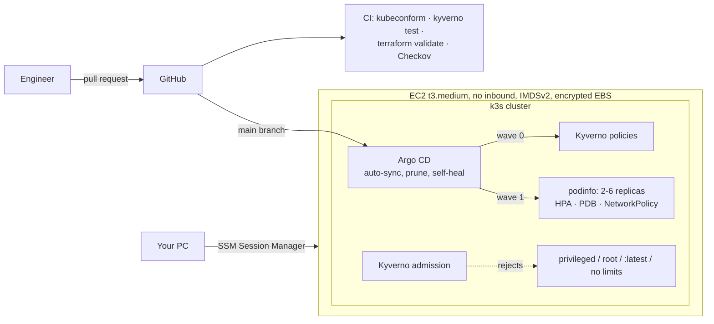

# Kubernetes GitOps Platform (k3s · Argo CD · Kyverno)


A small Kubernetes platform where Git is the only way to change the cluster. Argo CD syncs this repository and undoes manual drift; Kyverno blocks privileged, root, unpinned or unbounded pods at admission; the workload runs under Pod Security `restricted`, default-deny NetworkPolicy, a PodDisruptionBudget and a Horizontal Pod Autoscaler. The node runs on EC2 with no inbound ports, reached only through SSM Session Manager.

**Problem:** clusters drift when people `kubectl` by hand, and insecure pods slip in. **Outcome:** every change is reviewed and reversible in Git, drift heals itself, and risky workloads are rejected before they run.

## Architecture



## Policies (Kyverno, enforce mode)

| Policy | Blocks |
| --- | --- |
| disallow-privileged | `privileged: true` in any container |
| require-run-as-non-root | pods without `runAsNonRoot: true` |
| disallow-latest-tag | `:latest` or untagged images |
| require-requests-limits | containers without CPU/memory requests and a memory limit |

Each policy has a unit test that proves it blocks a bad pod and allows a good one: `kyverno test tests/kyverno` → 8 passed.

## Deploy

```bash
cd infra && cp terraform.tfvars.example terraform.tfvars    # owner, github_repo
terraform init && terraform apply
# wait about 5 minutes for first-boot bootstrap, then:
$(terraform output -raw connect)                              # shell on the node via SSM
sudo tail -f /var/log/k3s-bootstrap.log                       # until BOOTSTRAP COMPLETE
sudo k3s kubectl get applications -n argocd                   # policies, podinfo: Synced, Healthy
```

Argo CD UI from your PC:

```bash
# on the node: expose argocd-server on a NodePort
sudo k3s kubectl -n argocd patch svc argocd-server -p '{"spec":{"type":"NodePort","ports":[{"port":443,"targetPort":8080,"nodePort":30443,"name":"https"}]}}'
sudo k3s kubectl -n argocd get secret argocd-initial-admin-secret -o jsonpath='{.data.password}' | base64 -d; echo
# on your PC (needs the Session Manager plugin):
$(terraform output -raw argocd_port_forward)                  # then open https://localhost:8443, user admin
```

## Demos

| Demo | Command | What you see |
| --- | --- | --- |
| GitOps change | edit `replicas` in `k8s/apps/podinfo/deployment.yaml`, merge | Argo CD syncs within about 3 minutes |
| Self-heal | `kubectl -n podinfo scale deploy podinfo --replicas=5` | Argo CD sets it back to Git's value |
| Policy | `kubectl run bad --image=nginx:latest -n podinfo` | Rejected by disallow-latest-tag |
| Autoscale | `kubectl apply -f k8s/loadtest.yaml; kubectl -n podinfo get hpa -w` | Replicas rise toward 6, then fall back |

## Cost and teardown

About $1 a day (t3.medium plus 30 GB gp3). `terraform destroy` the same day.

## Why k3s instead of EKS

EKS charges about $73 a month for the control plane before any nodes. The skills here (manifests, Helm, Argo CD, Kyverno, HPA, NetworkPolicy, Pod Security) transfer directly. On EKS you would add managed node groups, IRSA or EKS Pod Identity for AWS permissions, the AWS Load Balancer Controller, and the cluster in private subnets.

Checkov: Terraform 23 passed, Kubernetes 174 passed, workflows 56 passed, 0 failed.

Design decisions and trade-offs: [docs/design-decisions.md](docs/design-decisions.md).
